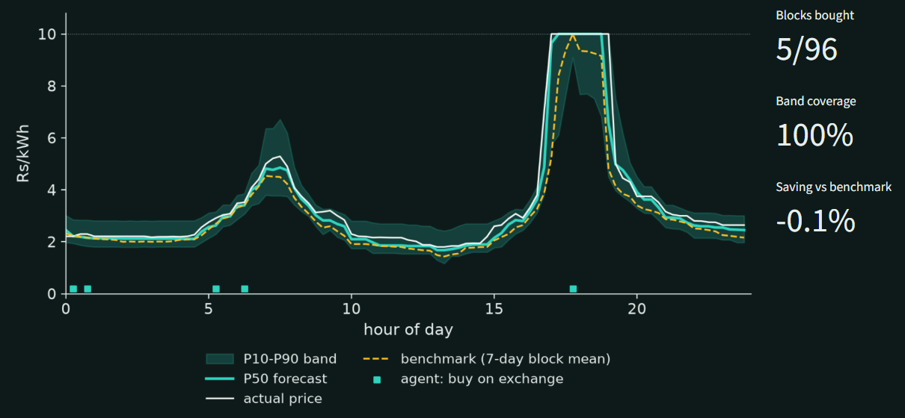
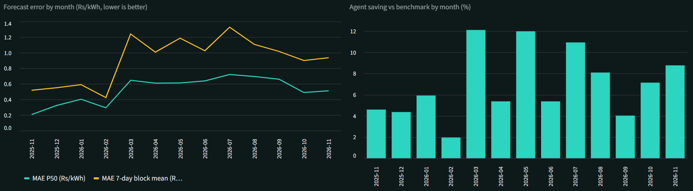
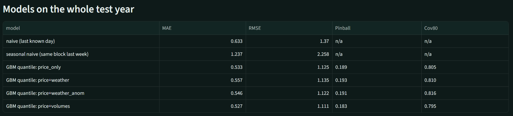

# IEX Day-Ahead Price Forecasting

Forecast the 96 fifteen-minute prices of the Indian Energy Exchange (IEX) day-ahead market (DAM)
**using only information available at bid time**, produce calibrated P10/P50/P90 bands, and feed them into a
rule-based agent that decides which blocks to buy on the exchange.

> **Status: working pipeline, run on real IEX data (May 2023 to November 2026), two evaluation folds.**
> Headline results and their limits are in [`docs/FINDINGS.md`](docs/FINDINGS.md). In short: a quantile GBM beats
> the naive baselines in both folds (MAE 0.53 vs 0.63-0.66 Rs/kWh) with a calibrated 80% band, and a forecast-based
> buy rule tuned on a validation window beats a "yesterday's price" rule in a stylised procurement simulation.
> Auction-volume and temperature features did not give a consistent gain once more history was used, and that
> is reported as such. A zero-shot foundation model (Chronos-2) was also evaluated and is clearly less accurate than
> the trained GBM in both folds (MAE 0.61-0.64 vs 0.53-0.55 Rs/kWh). The built-in synthetic generator remains available for tests and demos and is always
> labelled as such.

## Screenshots

Dashboard replay of the walk-forward test year (data: real IEX exports, 25 Nov 2025 to 24 Nov 2026).


*One delivery day: actual price, P50 forecast, calibrated P10-P90 band, 7-day benchmark and the blocks the agent buys.*


*Monthly forecast error against the benchmark, and the agent's monthly saving in the stylised simulation.*


*Model comparison on the whole test year.*

## Research question

> At the DAM bid deadline, how accurately can the next day's 96 block prices be forecast, how well calibrated is
> the stated uncertainty, and does acting on it lower procurement cost?

## Design principles

| Principle | Implementation |
|---|---|
| No look-ahead | `features.day_features` can only read prices up to the last day known at bid time (`INFO_LAG_DAYS`). A test destroys every later price and asserts that the features do not change. |
| Forecast inputs, not actuals | Weather, solar and demand enter as day-ahead *forecasts*. |
| Honest baselines | Naive and seasonal-naive forecasts may only use days known at bid time; the code rejects anything else. |
| Time-ordered evaluation | Walk-forward refits on data known at each refit date; no random splits. |
| Earned uncertainty | Quantile models plus conformal calibration (CQR); raw and calibrated coverage are both reported. |
| Evidence for every claim | Ablation ladder (price, weather, solar, demand) with Diebold-Mariano tests on daily errors. |
| Auditable decisions | The agent is a deterministic rule on the forecast bands; explanations are templates. |
| Explicit data provenance | Every report states whether it ran on synthetic, unverified or declared-real data. |

## Layout

```
iex_forecast/
  config.py       market constants and the information lag
  data.py         MarketData, CSV loader, data-quality checks, synthetic generator
  features.py     leak-free feature builder and ablation feature sets
  models.py       seasonal-naive baselines, quantile gradient boosting (scikit-learn or LightGBM)
  backtest.py     walk-forward harness and conformal calibration
  metrics.py      MAE, RMSE, pinball, coverage, directional accuracy, stratified errors, Diebold-Mariano
  agent.py        risk-adjusted decision rule, procurement simulation, explanations
  spike.py        spike-probability classifier         (tested; not yet in run_backtest.py)
  ensemble.py     validation-weighted blending         (tested; not used, no model was close enough to justify it)
  drift.py        PSI and rolling-error alerts         (tested; not yet in run_backtest.py)
  news.py         previous-day headline features       (tested; no data source wired in)
  foundation.py   leak-guarded evaluation harness for external forecasters
  chronos_adapter.py  zero-shot Chronos-2 quantile forecaster (optional dependency: chronos-forecasting)
app/              Streamlit dashboard (replay of the backtest) and FastAPI service over saved predictions
scripts/          build_dataset.py (IEX Excel exports -> CSV), add_weather.py (bid-time temperature forecast),
                  run_foundation.py (Chronos-2 vs GBM on the same test days), make_synthetic_csv.py
tests/            leakage, data loading, metrics, agent, walk-forward and calibration tests
docs/             market_notes.md, DATA_SOURCES.md, ROADMAP.md
run_backtest.py   end-to-end run -> results/
```

## Quick start

Windows (Command Prompt):

```
python -m venv .venv
.venv\Scripts\activate
pip install -r requirements.txt
python -m pytest -q
python run_backtest.py
```

macOS / Linux:

```
python3 -m venv .venv && source .venv/bin/activate
pip install -r requirements.txt
python -m pytest -q
python run_backtest.py
```

The backtest takes a few minutes and writes `results/RESULTS.md`, figures and `predictions.npz` (not committed to GitHub: it contains exchange prices).
Optional: `pip install -r requirements-optional.txt` and `set IEX_BACKEND=lightgbm` (Windows) or
`IEX_BACKEND=lightgbm python run_backtest.py` (macOS/Linux) to use LightGBM.
Dashboard and API: `pip install -r requirements-app.txt`, then `streamlit run app/dashboard.py`
or `uvicorn app.api:app --reload`. Docker: `docker build -t iex-forecast .` then
`docker run -p 8600:8600 iex-forecast` (dashboard on http://localhost:8600).
Foundation-model comparison (after a backtest): `pip install chronos-forecasting`, then
`python scripts/run_foundation.py --data data/iex_dam_weather.csv --results results --out results/foundation.md`.

## Using real data

1. Read `docs/market_notes.md` and `docs/DATA_SOURCES.md`.
2. Export IEX DAM market snapshots (15-minute interval, at most 31 days per file) from the exchange website into
   `data/raw/iex/` (check the exchange's terms of use; raw files are git-ignored).
3. `pip install -r requirements.txt`, then:
   ```
   python scripts/build_dataset.py        # Excel exports -> data/iex_dam.csv
   python scripts/add_weather.py          # optional: adds bid-time temperature forecasts (needs internet)
   python run_backtest.py --data data/iex_dam_weather.csv --real
   python run_backtest.py --data data/iex_dam_weather.csv --real --end-date 2025-11-24 --out results_fold1   # earlier fold
   ```
   Read the data-quality warnings it prints. Alternatively write a CSV in the schema of `data/README.md` yourself.

## Limitations

- Two chronological test years are evaluated (see `docs/FINDINGS.md` for caveats); this is still a short history.
- Solar and demand forecasts are not yet in the data, so those ablation rungs are skipped on real data.
- The bundled `results/` folder may come from the synthetic generator; check the "Data:" line at the top of
  `results/RESULTS.md`.
- The gate-closure time, the current price cap and the market-coupling status are tracked as open questions in
  `docs/market_notes.md`. `INFO_LAG_DAYS = 1` follows from the assumed clearing schedule.
- The data starts in May 2023, after the April 2023 cap revision, so the series is a single cap regime. Results are
  split by cap days versus other days, but not by earlier regimes, which are not in the data.
- The procurement simulation is a stylised toy (benchmark = trailing 7-day mean of the block, no volumes, limits or
  penalties). It is decision support, not a trading P&L, and not advice.
- The foundation-model test used one model (Chronos-2), zero-shot, price-only with a 14-day context. TimesFM and
  fine-tuning were not tried. The Chronos band is uncalibrated, so only the MAE comparison is like-for-like.
- The Dockerfile was built and run on Windows (Docker Desktop) and served the dashboard. The FastAPI service and the LightGBM backend have not been executed by the author.
- Conformal calibration assumes recent residuals resemble upcoming ones; coverage degrades at regime changes.
