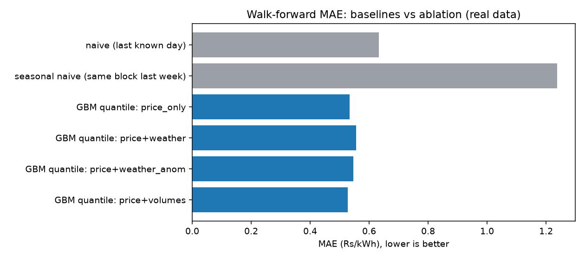
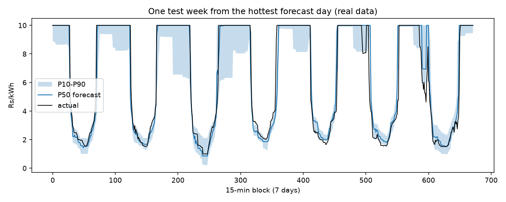

# Backtest results

> **Data: REAL (declared by the user; provenance is not verified by this code).**
> Real-data run. Confirm that the forecast columns were genuinely available at bid time.

Test period: 2025-11-25 to 2026-11-24 (365 days x 96 blocks).
Bid-time information: realised prices up to day D-1; weather, solar and demand are
day-ahead *forecasts*. Models are refit every 45 days on data known at that time.
Boosted-tree backend: scikit-learn HistGradientBoosting (quantile loss), unless `IEX_BACKEND=lightgbm`.
News features: not included (no news data source wired in).

Data-quality warnings:
- 18.9% of blocks sit at the price cap: check units (Rs/MWh vs Rs/kWh) and regimes
- some days have constant prices (forward-filled or missing data?)
- solar_fc not provided: its feature group is skipped
- demand_fc not provided: its feature group is skipped

## Model comparison and ablation
`DirAcc` = share of blocks where the forecast gets the direction of change vs the last
known day right; n/a for the naive baseline, which IS that reference.
`Cov80` = share of actuals inside the conformally calibrated P10-P90 band (target 0.80);
`Cov80 raw` = same band before calibration; `Cov80 fixed margin` = one conformal margin per refit
(the earlier design). The default band (`Cov80`) uses a rolling margin: for every test day it takes
the model's errors on the latest 60 days known at bid time. Pinball uses the default band.

| model | MAE | RMSE | DirAcc | Pinball | Cov80 | Cov80 raw | Cov80 fixed margin |
|---|---|---|---|---|---|---|---|
| naive (last known day) | 0.633 | 1.370 | n/a | n/a | n/a | n/a | n/a |
| seasonal naive (same block last week) | 1.237 | 2.258 | 0.596 | n/a | n/a | n/a | n/a |
| GBM quantile: price_only | 0.533 | 1.125 | 0.673 | 0.189 | 0.805 | 0.769 | 0.810 |
| GBM quantile: price+weather | 0.557 | 1.135 | 0.680 | 0.193 | 0.810 | 0.776 | 0.814 |
| GBM quantile: price+weather_anom | 0.546 | 1.122 | 0.680 | 0.191 | 0.816 | 0.786 | 0.821 |
| GBM quantile: price+volumes | 0.527 | 1.111 | 0.674 | 0.183 | 0.795 | 0.760 | 0.791 |

## Significance (Diebold-Mariano on daily MAE, with 95% block-bootstrap intervals of the MAE difference)
| model A | vs model B | MAE diff (A-B) | 95% CI | DM stat (neg = A better) | p-value |
|---|---|---|---|---|---|
| GBM quantile: price_only | seasonal naive (same block last week) | -0.7040 | [-0.866, -0.551] | -8.5608 | 0.0000 |
| GBM quantile: price_only | naive (last known day) | -0.0996 | [-0.133, -0.062] | -5.3367 | 0.0000 |
| GBM quantile: price+weather | seasonal naive (same block last week) | -0.6806 | [-0.839, -0.531] | -8.5656 | 0.0000 |
| GBM quantile: price+weather | naive (last known day) | -0.0762 | [-0.115, -0.030] | -3.5153 | 0.0004 |
| GBM quantile: price+weather_anom | seasonal naive (same block last week) | -0.6911 | [-0.854, -0.539] | -8.4830 | 0.0000 |
| GBM quantile: price+weather_anom | naive (last known day) | -0.0868 | [-0.122, -0.046] | -4.4175 | 0.0000 |
| GBM quantile: price+volumes | seasonal naive (same block last week) | -0.7098 | [-0.871, -0.556] | -8.5836 | 0.0000 |
| GBM quantile: price+volumes | naive (last known day) | -0.1054 | [-0.136, -0.070] | -5.9918 | 0.0000 |
| GBM quantile: price+weather | GBM quantile: price_only | 0.0234 | [0.007, 0.044] | 2.4687 | 0.0136 |
| GBM quantile: price+weather_anom | GBM quantile: price_only | 0.0128 | [0.000, 0.027] | 1.8719 | 0.0612 |
| GBM quantile: price+weather_anom | GBM quantile: price+weather | -0.0106 | [-0.026, 0.002] | -1.5432 | 0.1228 |
| GBM quantile: price+volumes | GBM quantile: price_only | -0.0058 | [-0.019, 0.007] | -0.8944 | 0.3711 |

## Where the chosen rung (GBM quantile: price+weather_anom; selected by validation MAE (before the test period)) is strong / weak (MAE)
| group | slice | best rung MAE | seasonal naive MAE |
|---|---|---|---|
| time of day | night (00-06) | 0.666 | 1.841 |
| time of day | morning (06-10) | 0.637 | 1.301 |
| time of day | solar (10-17) | 0.358 | 0.664 |
| time of day | evening peak (17-23) | 0.601 | 1.299 |
| time of day | late (23-24) | 0.448 | 1.000 |
| season | winter (Dec-Feb) | 0.340 | 0.543 |
| season | summer (Mar-Jun) | 0.626 | 1.562 |
| season | monsoon (Jul-Sep) | 0.692 | 1.485 |
| season | post-monsoon (Oct-Nov) | 0.470 | 1.238 |
| day type | weekday | 0.531 | 1.169 |
| day type | weekend | 0.582 | 1.408 |
| regime | cap days: 12+ blocks at cap (n=225) | 0.592 | 1.286 |
| regime | other days | 0.473 | 1.158 |

## Stylised procurement simulation (agent)
One agent row per model rung with the fixed default parameters (lambda=0.5, guard=0.95), plus one row
whose model and parameters were chosen on the validation window (validation MAE (before the test period)). Sample explanations and
`predictions.npz` use the chosen rung and, when available, the tuned parameters.
A buyer either buys each block on the day-ahead market or defers to a benchmark price
(trailing 7-day mean of that block). Agent parameters were fixed before looking at the
test period. This is a toy economic model, not a trading P&L.

| strategy | avg cost (Rs/kWh) | saving vs benchmark (%) | share of oracle saving captured (%) | blocks bought on DAM (%) |
|---|---|---|---|---|
| always buy DAM | 4.886 | -0.189 | -1.980 | 100.000 |
| never buy (benchmark only) | 4.877 | 0.000 | 0.000 | 0.000 |
| naive rule (buy if last known price < benchmark) | 4.625 | 5.154 | 54.069 | 37.885 |
| agent (price_only) | 4.637 | 4.910 | 51.516 | 14.184 |
| agent (price+weather) | 4.645 | 4.760 | 49.936 | 14.090 |
| agent (price+weather_anom) | 4.639 | 4.869 | 51.084 | 14.258 |
| agent (price+volumes) | 4.653 | 4.581 | 48.058 | 12.705 |
| agent TUNED on validation (price+weather_anom, lambda=0.0, guard=1.01) | 4.527 | 7.177 | 75.293 | 43.596 |
| oracle (hindsight, upper bound) | 4.412 | 9.532 | 100.000 | 38.413 |

Tuned agent vs naive rule, daily procurement cost: mean difference -0.099 Rs/kWh (95% block-bootstrap CI [-0.127, -0.072]; negative = agent cheaper), DM statistic -7.23, p-value 0.0000.

## Validation window (days 699-938, before the test period)
| model | validation MAE |
|---|---|
| GBM quantile: price_only | 0.591 |
| GBM quantile: price+weather | 0.586 |
| GBM quantile: price+weather_anom | 0.573 |
| GBM quantile: price+volumes | 0.578 |

Best 5 agent parameter pairs on the validation window:

| lambda | spike guard | avg cost (Rs/kWh) |
|---|---|---|
| 0.000 | 1.010 | 3.604 |
| 0.250 | 1.010 | 3.629 |
| -0.250 | 1.010 | 3.630 |
| 0.000 | 0.990 | 3.656 |
| -0.250 | 0.990 | 3.669 |

## Sample agent explanations
- 2026-04-24: evening peak (18-22h) P50 Rs10.00/kWh (P10 9.00 - P90 10.00), confidence HIGH. Drivers: normal seasonal pattern. Plan: buy on DAM in 53/96 blocks.
- 2026-01-03: evening peak (18-22h) P50 Rs7.30/kWh (P10 5.22 - P90 8.39), confidence HIGH. Drivers: weekend demand dip. Plan: buy on DAM in 4/96 blocks.
- 2025-11-25: evening peak (18-22h) P50 Rs5.42/kWh (P10 4.23 - P90 6.16), confidence HIGH. Drivers: normal seasonal pattern. Plan: buy on DAM in 5/96 blocks.

_Runtime: 450s_
