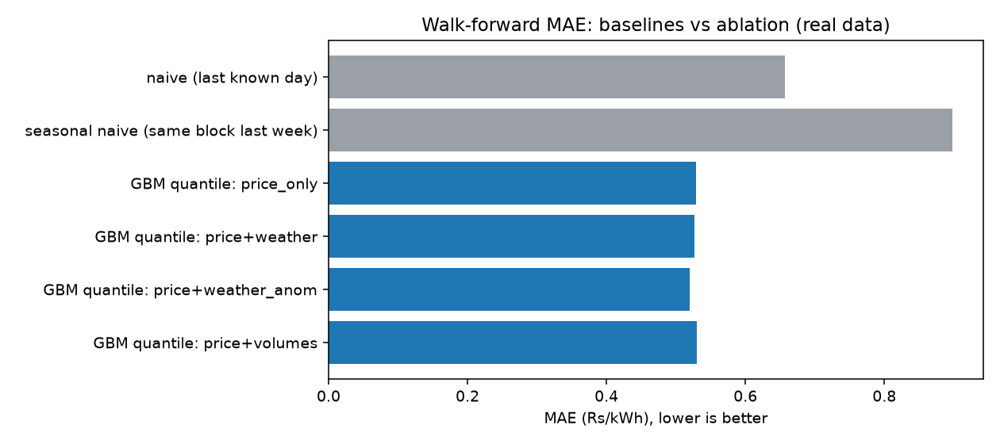
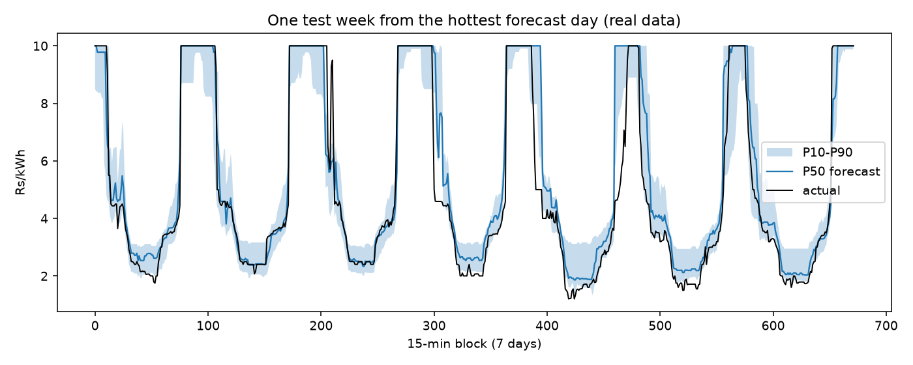

# Backtest results

> **Data: REAL (declared by the user; provenance is not verified by this code).**
> Real-data run. Confirm that the forecast columns were genuinely available at bid time.

Test period: 2024-11-25 to 2025-11-24 (365 days x 96 blocks).
Bid-time information: realised prices up to day D-1; weather, solar and demand are
day-ahead *forecasts*. Models are refit every 45 days on data known at that time.
Boosted-tree backend: scikit-learn HistGradientBoosting (quantile loss), unless `IEX_BACKEND=lightgbm`.
News features: not included (no news data source wired in).

Data-quality warnings:
- 16.4% of blocks sit at the price cap: check units (Rs/MWh vs Rs/kWh) and regimes
- some days have constant prices (forward-filled or missing data?)
- solar_fc not provided: its feature group is skipped
- demand_fc not provided: its feature group is skipped

## Model comparison and ablation
`DirAcc` = share of blocks where the forecast gets the direction of change vs the last
known day right; n/a for the naive baseline, which IS that reference.
`Cov80` = share of actuals inside the conformally calibrated P10-P90 band (target 0.80);
`Cov80 raw` = same band before calibration; `Cov80 fixed margin` = one conformal margin per refit
(the earlier design). The default band (`Cov80`) uses a rolling margin: for every test day it takes
the model's errors on the latest 60 days known at bid time. Pinball uses the default band.

| model | MAE | RMSE | DirAcc | Pinball | Cov80 | Cov80 raw | Cov80 fixed margin |
|---|---|---|---|---|---|---|---|
| naive (last known day) | 0.657 | 1.328 | n/a | n/a | n/a | n/a | n/a |
| seasonal naive (same block last week) | 0.898 | 1.640 | 0.624 | n/a | n/a | n/a | n/a |
| GBM quantile: price_only | 0.528 | 0.978 | 0.662 | 0.180 | 0.798 | 0.711 | 0.783 |
| GBM quantile: price+weather | 0.527 | 0.981 | 0.668 | 0.179 | 0.794 | 0.720 | 0.787 |
| GBM quantile: price+weather_anom | 0.520 | 0.970 | 0.668 | 0.178 | 0.790 | 0.734 | 0.790 |
| GBM quantile: price+volumes | 0.530 | 0.983 | 0.659 | 0.178 | 0.796 | 0.705 | 0.786 |

## Significance (Diebold-Mariano on daily MAE, with 95% block-bootstrap intervals of the MAE difference)
| model A | vs model B | MAE diff (A-B) | 95% CI | DM stat (neg = A better) | p-value |
|---|---|---|---|---|---|
| GBM quantile: price_only | seasonal naive (same block last week) | -0.3691 | [-0.455, -0.293] | -8.4897 | 0.0000 |
| GBM quantile: price_only | naive (last known day) | -0.1287 | [-0.164, -0.094] | -6.5468 | 0.0000 |
| GBM quantile: price+weather | seasonal naive (same block last week) | -0.3706 | [-0.456, -0.295] | -8.5470 | 0.0000 |
| GBM quantile: price+weather | naive (last known day) | -0.1301 | [-0.167, -0.094] | -6.4812 | 0.0000 |
| GBM quantile: price+weather_anom | seasonal naive (same block last week) | -0.3778 | [-0.464, -0.302] | -8.5857 | 0.0000 |
| GBM quantile: price+weather_anom | naive (last known day) | -0.1374 | [-0.172, -0.105] | -7.3613 | 0.0000 |
| GBM quantile: price+volumes | seasonal naive (same block last week) | -0.3677 | [-0.456, -0.292] | -8.3091 | 0.0000 |
| GBM quantile: price+volumes | naive (last known day) | -0.1273 | [-0.159, -0.095] | -7.1012 | 0.0000 |
| GBM quantile: price+weather | GBM quantile: price_only | -0.0014 | [-0.009, 0.006] | -0.3681 | 0.7128 |
| GBM quantile: price+weather_anom | GBM quantile: price_only | -0.0087 | [-0.017, -0.001] | -2.0592 | 0.0395 |
| GBM quantile: price+weather_anom | GBM quantile: price+weather | -0.0073 | [-0.017, 0.002] | -1.4569 | 0.1452 |
| GBM quantile: price+volumes | GBM quantile: price_only | 0.0014 | [-0.011, 0.014] | 0.2200 | 0.8259 |

## Where the chosen rung (GBM quantile: price+volumes; selected by validation MAE (before the test period)) is strong / weak (MAE)
| group | slice | best rung MAE | seasonal naive MAE |
|---|---|---|---|
| time of day | night (00-06) | 0.477 | 0.935 |
| time of day | morning (06-10) | 0.522 | 0.896 |
| time of day | solar (10-17) | 0.364 | 0.511 |
| time of day | evening peak (17-23) | 0.761 | 1.234 |
| time of day | late (23-24) | 0.656 | 1.366 |
| season | winter (Dec-Feb) | 0.419 | 0.546 |
| season | summer (Mar-Jun) | 0.643 | 1.224 |
| season | monsoon (Jul-Sep) | 0.553 | 0.908 |
| season | post-monsoon (Oct-Nov) | 0.433 | 0.747 |
| day type | weekday | 0.527 | 0.908 |
| day type | weekend | 0.538 | 0.873 |
| regime | cap days: 12+ blocks at cap (n=172) | 0.505 | 0.915 |
| regime | other days | 0.552 | 0.882 |

## Stylised procurement simulation (agent)
One agent row per model rung with the fixed default parameters (lambda=0.5, guard=0.95), plus one row
whose model and parameters were chosen on the validation window (validation MAE (before the test period)). Sample explanations and
`predictions.npz` use the chosen rung and, when available, the tuned parameters.
A buyer either buys each block on the day-ahead market or defers to a benchmark price
(trailing 7-day mean of that block). Agent parameters were fixed before looking at the
test period. This is a toy economic model, not a trading P&L.

| strategy | avg cost (Rs/kWh) | saving vs benchmark (%) | share of oracle saving captured (%) | blocks bought on DAM (%) |
|---|---|---|---|---|
| always buy DAM | 3.994 | 0.038 | 0.400 | 100.000 |
| never buy (benchmark only) | 3.996 | 0.000 | 0.000 | 0.000 |
| naive rule (buy if last known price < benchmark) | 3.849 | 3.661 | 38.657 | 43.630 |
| agent (price_only) | 3.862 | 3.334 | 35.211 | 9.358 |
| agent (price+weather) | 3.842 | 3.831 | 40.458 | 10.825 |
| agent (price+weather_anom) | 3.853 | 3.563 | 37.621 | 10.990 |
| agent (price+volumes) | 3.871 | 3.128 | 33.033 | 8.593 |
| agent TUNED on validation (price+volumes, lambda=0.0, guard=1.01) | 3.766 | 5.746 | 60.674 | 32.740 |
| oracle (hindsight, upper bound) | 3.617 | 9.470 | 100.000 | 44.152 |

Tuned agent vs naive rule, daily procurement cost: mean difference -0.083 Rs/kWh (95% block-bootstrap CI [-0.101, -0.064]; negative = agent cheaper), DM statistic -8.25, p-value 0.0000.

## Validation window (days 334-573, before the test period)
| model | validation MAE |
|---|---|
| GBM quantile: price_only | 0.634 |
| GBM quantile: price+weather | 0.646 |
| GBM quantile: price+weather_anom | 0.626 |
| GBM quantile: price+volumes | 0.601 |

Best 5 agent parameter pairs on the validation window:

| lambda | spike guard | avg cost (Rs/kWh) |
|---|---|---|
| 0.000 | 1.010 | 4.342 |
| -0.250 | 1.010 | 4.355 |
| 0.250 | 1.010 | 4.364 |
| 0.000 | 0.990 | 4.377 |
| 0.000 | 0.950 | 4.382 |

## Sample agent explanations
- 2025-05-14: evening peak (18-22h) P50 Rs8.71/kWh (P10 7.53 - P90 8.97), confidence HIGH. Drivers: normal seasonal pattern. Plan: buy on DAM in 1/96 blocks.
- 2025-01-04: evening peak (18-22h) P50 Rs5.27/kWh (P10 4.14 - P90 5.88), confidence HIGH. Drivers: weekend demand dip. Plan: buy on DAM in 63/96 blocks.
- 2024-11-25: evening peak (18-22h) P50 Rs4.52/kWh (P10 3.51 - P90 5.37), confidence HIGH. Drivers: normal seasonal pattern. Plan: buy on DAM in 10/96 blocks.

_Runtime: 316s_
